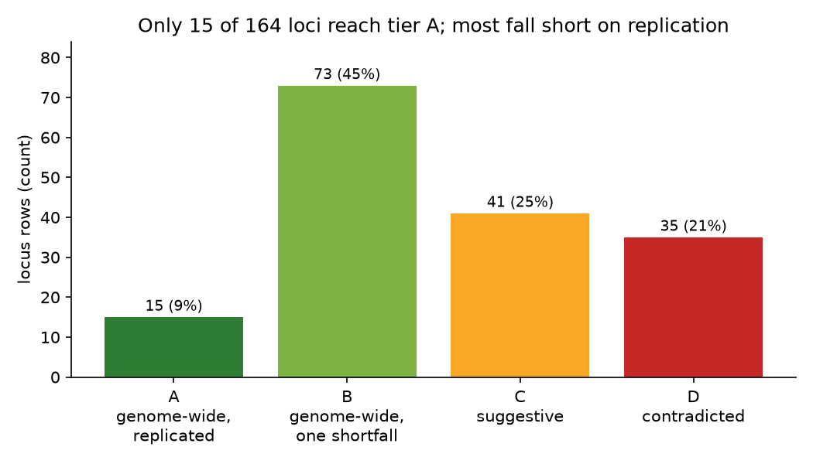
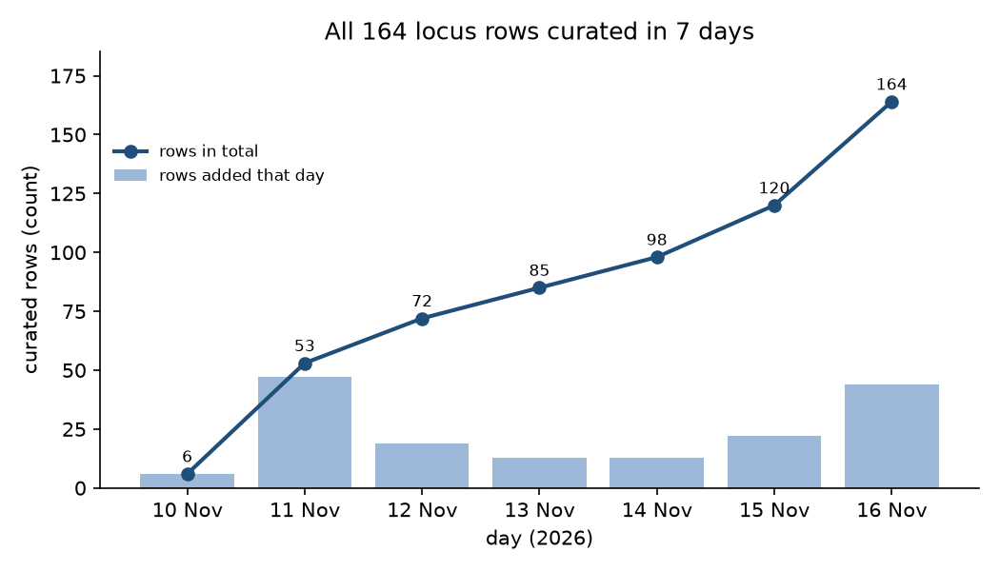

# longevity-loci

A re-curation of the human longevity genetics in just-dna's `longevitymap` annotation module, built from the
evidence up. Each locus is a reviewed row, every claim in it cites a passage quoted word for word from its source,
and the module is compiled from those rows.

The work was done by a team of six Claude Code agents, each holding a standing role ("seat"), steered by the
repository's maintainer through chat and a question desk. This page describes what they produced and how.

**Results page:** [tiers, every locus, loci by mechanism](https://claude.ai/artifact/9Ga73vyTsg4ZjwJSg4M7Q4).

## Why

The module's v1 was a port of HAGR's LongevityMap, frozen since June 2017. It mixed small candidate-gene studies,
many never replicated, with genome-wide results, and scored them alike. The redesign in
[`docs/longevitymap_v2/`](docs/longevitymap_v2/README.md) asks for something stricter. Every scored locus carries
seven axes, reported separately and never summed: evidence tier, mechanism, pleiotropy, age of action, outcome
profile (healthspan, lifespan, exceptional survival), actionability, and ancestry and sex context. Only a
genome-wide, replicated signal may move a score. That design came with a seed list of 161 loci, each with a
provisional tier. This repository tests every seed locus against its evidence.

## Where it stands (2026-11-17)

- 🟢 **Curation done.** All 161 seed loci are curated in 156 rows (some seed entries named one signal and were
  folded together). Eight independent second signals beside existing loci add rows 162 to 169, for 164 rows.
- 🟢 **Every quote checked.** 6,531 quotes were found word for word in their cached source, 1 could not be checked
  (a database note with no cached text), and none failed.
- 🟢 **The module builds.** It compiles strict on just-dna-format 0.8: 489 genotype rows and 679 studies, with
  APOE scored as 12 results, one per ε pair.
- 🟡 **Not yet published.** The module sits on the registry's test instance only, as
  `test-longevity-loci/longevitymap` 2.0.0. It goes to production only on the maintainer's word.

## What the evidence says

**Only 15 of 164 loci (9 %) reach tier A**, which needs a genome-wide hit (N ≥ 100,000, P < 5×10⁻⁸), an
independent replication and no red flag. Most loci are genome-wide but fall short on replication. 35 rows are at
D: their discovery failed a powered test in its own ancestry, or its own authors called it anomalous.



| Tier | Means | Rows |
|---|---|---|
| A | genome-wide, independently replicated, no red flag; scored | 15 |
| B | genome-wide with one shortfall (usually no independent replication) | 73 |
| C | suggestive only | 41 |
| D | contradicted: failed a powered test, or called anomalous by its authors | 35 |

By mechanism, most loci act through no single system the evidence shows (108 rows, `general_ageing`). The
named ones are heart and vessels (16), metabolism (8), smoking and lungs (4), immune and inflammation (4), skin
and sun (3) and brain and memory (1). One row is a legacy candidate-gene locus. The 19 biological-ageing marker
rows (telomere length, epigenetic clocks, brain age, loss of Y) are an unscored section on the maintainer's
decision: they inform and move no score.

Some seed tiers did not hold once the papers were read. The first pilot row, 67 TTC12, dropped from A to B. These
are curation results, not medical advice. A tier says how strong the evidence for an association is. It does not
say a variant causes longer life, nor how large the effect is for one person.

## How a row is made

1. **Find.** The scout searches the literature since 2017, track by track (GWAS, rare variants, healthspan,
   preprints), and queues each paper that bears on a locus.
2. **Read.** The curator reads the articles a locus rests on, at the depth the claim needs: abstract, full text,
   supplement tables, data deposits, summary statistics, database releases (Open Targets, Ensembl LD, the GWAS
   Catalog, FinnGen).
3. **Write.** The curator writes one YAML row per locus (`rows/`) and one evidence note per source (`corpus/`).
   Each axis value in the row cites quote ids in the notes.
4. **Check.** `loci check rows` enforces the hard rules: tier gates, required fields, a neutral genotype, the
   seed's names. `loci check quotes` finds every quote verbatim in the cached text and reports unknown when it
   cannot look, never a pass.
5. **Challenge.** After each batch of about ten rows, the lead runs three independent adversarial reads of the
   batch. Every finding is settled as a numbered decision in
   [`docs/DECISIONS.md`](docs/DECISIONS.md), and the curator applies the corrections. Seventeen batches were read
   this way.
6. **Build.** The module seat exports the rows to just-dna-format 0.8 (`loci export`), validates and compiles
   strict, and rehearses on the registry's test instance.

The article texts are cached outside git: the repository is public and the articles are not ours. A note keeps
citations, short verbatim quotes and verdicts only.

## The team

Six seats, each a Claude Code session run on the seats kit (agent-seat-blueprints).
Each seat's brief is in [`docs/seats/`](docs/seats/README.md), with the notes it keeps for whoever holds it next.

| Seat | Role |
|---|---|
| **lead** | Builds the code the others run (formats, checks, fetchers, the export), runs the adversarial reads, keeps the plan, reports to the maintainer. |
| **curator** | Re-reads each locus against its articles and writes the row and its notes. |
| **scout** | Sweeps the recent literature and queues new papers and second signals. |
| **module** | Builds the annotation module from the rows and rehearses each version on the registry's test instance. |
| **runner** | Runs bulk fetches as batch jobs on the cluster and logs them in `runs/`. |
| **liaison** | Tracks the tools upstream (module-creator plugin, just-dna compiler and format, the registry) and files their defects there. |

The maintainer set the direction and settled the forks that had a real cost either way, such as APOE scored per ε
pair, the marker loci unscored, and pacing. Everything else the seats decided, recorded with the alternative they
rejected.



In numbers, 4 to 17 November 2026: over 1,000 commits, 164 rows, 92 evidence notes (83 articles, 2 preprints,
7 database releases), decisions D1 to D40, 17 adversarial batch reads, and a rehearsal on the test registry
after each batch. Defects
found in the upstream tools went to their owners' issue trackers rather than being patched here.

## Layout

| Path | What it holds |
|---|---|
| `rows/` | one curated row per locus, `<locus_id>-<name>.yaml`; `rows/PROGRESS.md` the order |
| `corpus/` | one evidence note per source: `pmid-…`, `doi-…` (preprints), `db-…` (database releases) |
| `module/` | the module's spec and tables, as compiled |
| `scout/` | the searches by track, and the queue of papers waiting for a row |
| `runs/` | the runner's log of batch jobs |
| `src/longevity_loci/` | the formats' models and the `loci` command |
| `docs/` | formats, decisions, changelog, roadmap, the v2 research design, the seats' briefs |

The row and note formats are in [`docs/FORMATS.md`](docs/FORMATS.md), and what landed when is in
[`docs/CHANGELOG.md`](docs/CHANGELOG.md).

## Running it

Python 3.13+ and [uv](https://docs.astral.sh/uv/).

```sh
uv sync
uv run pytest                 # the tests; the quote tests fetch one real abstract and skip offline
uv run loci check rows        # every row parses and cites only quotes the corpus holds
LOCI_CACHE=… uv run loci fetch PMID…          # cache an article's text (Europe PMC)
LOCI_CACHE=… uv run loci check quotes         # every quote found verbatim in the cache
uv run loci export            # rows onto just-dna-format 0.8's tables, in module/
```

The README's figures are drawn from `rows/` and the git history by `scripts/readme_figures.py`.

## Limits

- Agents did the curation. Every quote is checked mechanically, but the reading of a quote (does this P value
  replicate that hit, is this sample independent) is a judgement. The adversarial reads caught the curator's
  mistakes and the lead's own, and they will not have caught all of them.
- The evidence is mostly European. Ancestry is recorded per study, and a European-only row says so.
- Two rows wait on a source: 165 needs a quoted heterogeneity test before it can reach A, and 167's mechanism
  moves once its source is cached.
