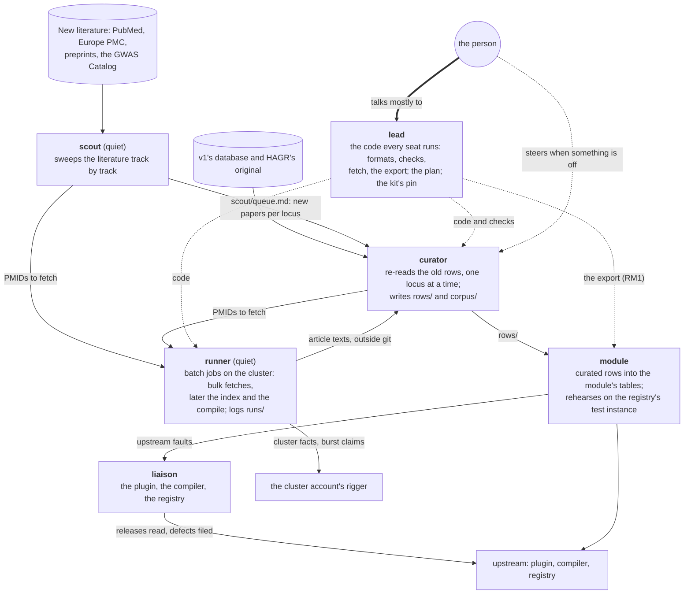

# Seats: standing roles a session can take in this repo

A **seat** is a fixed role a Claude Code session takes for its whole run. The seats here run on the seats kit
(`agent-seat-blueprints`): its plugin is pinned in the clone, and its base, loaded at every session start, holds
what every seat knows: messages, the desk, unattended runs, who speaks. Every seat also loads `CLAUDE.md`.

This repository re-curates the longevity module (the successor of the v1 port of HAGR's LongevityMap) from its
evidence: every row re-read against its articles, the literature since 2017 searched, and the annotation module
rebuilt from what holds. Three research seats do that; the lead builds the code they need; the liaison keeps
the tools they stand on. The seats run on the cluster, for the volume of texts and databases (the person,
2026-11-04); the cluster's names and paths stay out of the repository, which is public.

| Seat | Priming | Notes | Reached by | What it does |
|---|---|---|---|---|
| **lead** | [LEAD.md](LEAD.md), on the kit's `lead` role | [LEAD_NOTES.md](LEAD_NOTES.md) | the person; a need from any seat here | Builds the repository's code for the researchers: the row and corpus formats, the scripts, the checks; keeps the plan; merges. |
| **curator** | [CURATOR.md](CURATOR.md), this repository's own | [CURATOR_NOTES.md](CURATOR_NOTES.md) | the scout's queue; the module seat's question | Re-reads each locus row against its articles and writes the extended row with its evidence. |
| **scout** | [SCOUT.md](SCOUT.md), this repository's own | [SCOUT_NOTES.md](SCOUT_NOTES.md) | its own sweeps; a seat asking what is new on a locus | Searches the recent literature track by track and queues each paper that bears on a locus. |
| **module** | [MODULE.md](MODULE.md), this repository's own | [MODULE_NOTES.md](MODULE_NOTES.md) | curated rows landing; the curator and the scout | Builds the annotation module from the curated rows, version by version, and rehearses each on the registry's test instance. |
| **runner** | [RUNNER.md](RUNNER.md), on the kit's `runner` role | [RUNNER_NOTES.md](RUNNER_NOTES.md) | a research seat's fetch request; the lead's index or compile; a job's end | Submits, watches and logs the repository's batch jobs on the cluster, within the share the rigger states, and tells the seat that asked when each ends. |
| **liaison** | [LIAISON.md](LIAISON.md), on the kit's `liaison` role | [LIAISON_NOTES.md](LIAISON_NOTES.md) | a release or a defect of the module tooling | Tracks the module-creator plugin, the compiler's packages and the registry; files their defects where each producer takes them. |

## How the work flows

The person talks mostly to the lead; the other seats come to them only for a decision, in the repository's channel
while they are present and on their desk while they are away. The scout and the runner are quiet seats
(`presence = false`): they work the same whether the person is there or not. The other four turn unattended when
the person is away, building what is decided and putting each open question on the desk with its default.

The curator, the scout and the module seat start as this repository's own seat texts (the person, 2026-11-04);
what holds after some weeks of running becomes kit roles for repositories that re-curate a dataset the same way.

No tooling seat: a fault in the kit's tools is filed on the kit's issues (the skill `report-to-kit`), and the lead
moves the kit's pin. The team file is on the person's desk, since this repository is public.
